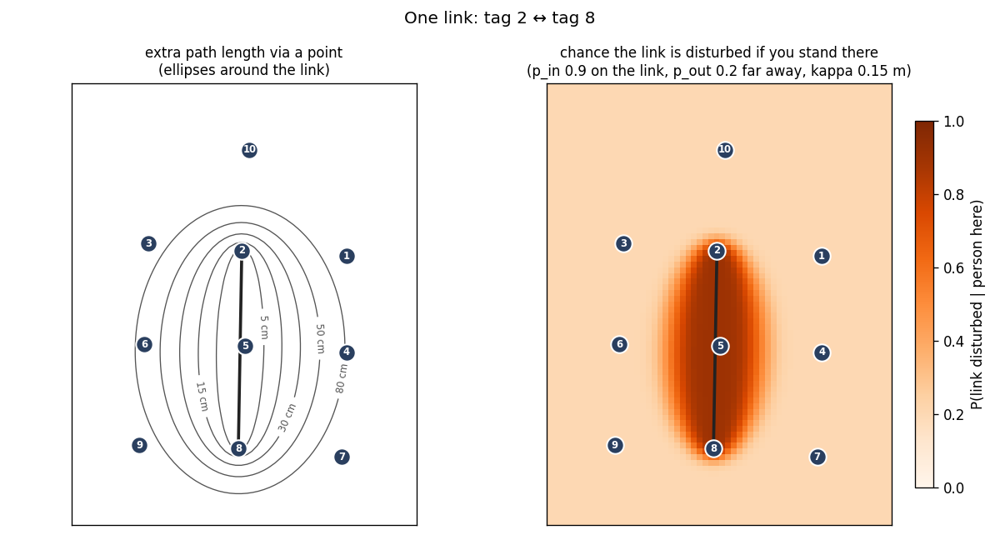
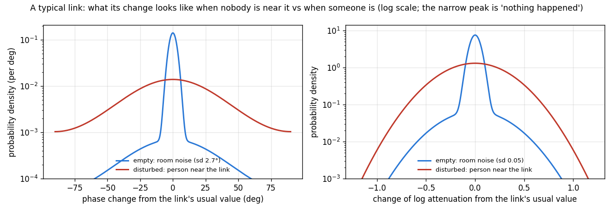
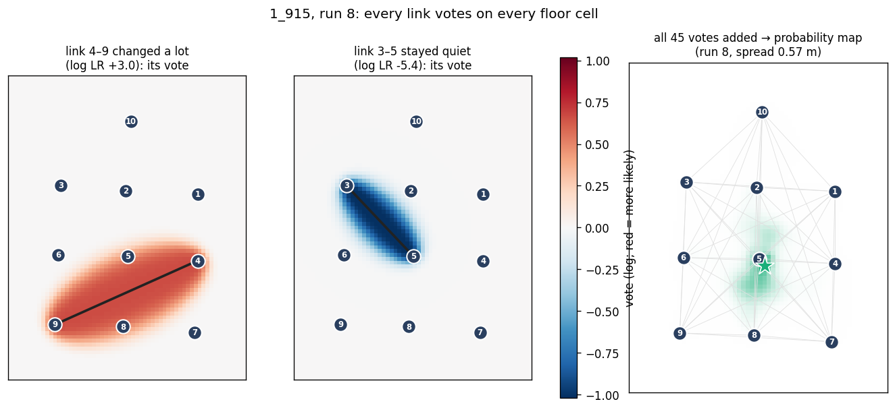
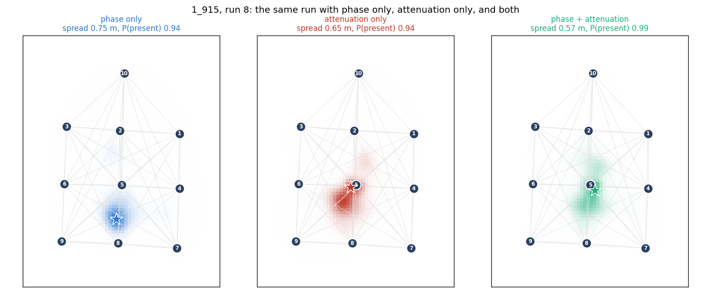

# Probability map of a person from RF links: algorithm

Script: `link_likelihood_map.py`. Figures: `link_likelihood_map_doc_figures.py` → `link_likelihood_map_doc/`.
Data: `human_tracking_grid_data/` (`1_915`, `2_915`, `3_915`; empty room `baseline915`).

- **Part 1** explains the idea in plain words with pictures.
- **Part 2** gives the maths and the exact details of the implementation.

---

# Part 1: the simple version

## The setup

- 10 tags stand on the floor. Every pair of tags talks to each other, so there are **45 links**.
- One **run** = every link measured once. That takes about 0.4 s, and then there is a ~2.4 s gap. A run comes every ~2.85 s.
- For every link, in every run, we get two numbers:
  - **phase**: how far the wave travelled, as an angle;
  - **attenuation**: how much weaker the signal got.
- When a person walks near a link, both numbers change.

The goal: from the 45 links of **one run**, draw a map of **how likely it is that the person is at each spot on the floor**. We don't want a single dot; we want a map that can say "probably here, maybe there".

## Idea 1: each link "sees" an oval around itself

A link is most affected when the person stands **on or near the straight line between its two tags**.
Points that are equally "near" the link form ovals (ellipses) with the two tags at the ends.



- **Left:** how much longer the path would be if the signal had to bounce off a person standing there. On the line it's 0 cm. The farther away the person is, the bigger the extra path.
- **Right:** the chance that this link gets disturbed if you stand there:
  - about **90%** right on the link;
  - about **20%** far away. It isn't 0%, because indoors the signal bounces off walls and people, so even a far-away person can change a link.

## Idea 2: for each link, ask "did it change, or is this just normal noise?"

We know how jittery each link is when the room is empty (from `baseline915`).



- **Blue (empty room):** the change is almost always tiny. That's the narrow spike.
- **Red (someone near):** the change can be big, in phase **and** in attenuation.
- For every link we look at its change in this run and ask **how much better red explains it than blue**. That's the link's **evidence** that someone is near it.
  - A big change gives strong evidence for "someone is near this link".
  - A tiny change gives evidence **against** "someone is near this link".
  - No single link can shout too loudly: the evidence is capped, because tags sometimes just glitch.

## Idea 3: every link votes on every spot of the floor



- **A link that changed a lot** (left) says "the person is probably somewhere in my oval". It paints its oval red, which means more likely.
- **A link that stayed quiet** (middle) says "the person is probably *not* in my oval, or I would have changed". It paints its oval blue, which means less likely.
- **All 45 votes are added up** (right). The spot with the most "yes" votes and the fewest "no" votes wins. The result is turned into a probability map that sums to 1 over the floor.
  - Star = most likely spot.
  - Contours = the smallest regions that contain the person with 50% and 90% probability.
  - Spread = roughly how big the uncertain area is, in metres.

## Idea 4: also ask "is anyone here at all?"

The same votes can be compared with the story **"nobody is in the room"**. In that story, every link is only disturbed by chance. If the links changed much more than that story allows, then **P(present)** is high.
- Experiment, typical run: P(present) ≈ 0.99.
- Empty room, typical run: P(present) ≈ 0.37.

## Phase only, attenuation only, or both

We can use only the phase change, only the attenuation change, or both. Using both gives the tightest map.



| | map spread (median) | P(present), experiment | P(present), empty room |
|---|---|---|---|
| phase only | 0.60 m | 0.96 | 0.37 |
| attenuation only | 0.66 m | 0.94 | 0.40 |
| phase + attenuation | 0.48 m | 0.99 | 0.37 |

## What the video shows

- **Camera:** only the frames around each run, from 0.5 s before the run starts to 0.5 s after it ends, played at half speed. The time between runs is skipped. The title says whether the frame is before, **DURING** or after the run.
- **Top right:** the links, coloured by how strongly each one says "disturbed".
- **Middle:** the three maps (phase only, attenuation only, both) for that run.
- **Bottom:** P(present) over time; the yellow band is the run being shown.
- **Every run is judged on its own.** There is no memory from one run to the next.

## What doesn't work well yet

- **Almost every link looks disturbed in almost every run.** The person changes links all over the room through reflections. So most votes are "yes" everywhere, and the map leans on the few quiet links. That pulls it towards the middle of the layout.
- The settings (oval width, 90%, 20%, …) are **chosen by hand**. When we let the data pick them, it picks "links are disturbed no matter where you stand", which gives no location information. That tells us the simple oval model needs improving (Part 2, last section).
- **No ground truth** has been used yet. "Sharp" maps aren't necessarily "correct" maps.

---

# Part 2: the detailed version

## 2.1 Measurements

For every link $l = (a, b)$, $a < b$, and run $k$ there are two MPPs (Rx $= a$, Tx $= b$ and the reverse), with unidirectional phase $\Theta$, amplitude $V$ and $\beta$. As in the earlier pipeline (`bidirectional` in `link_distance_video.py`):

$$
\hat\theta_{kl} = \tfrac12(\Theta_1 + \Theta_2) \bmod \pi, \qquad
\hat\alpha_{kl} = \tfrac12\Big(\frac{\beta_1}{V_2} + \frac{\beta_2}{V_1}\Big), \qquad
\ell_{kl} = \log \hat\alpha_{kl}.
$$

Phase is only known modulo $\pi$ (180°). Each run has:
- a **start** time $s_k = \min$ over its MPPs of the start time;
- an **end** time $t_k = \max$ over links of the later MPP stop. The run "exists" from $t_k$.

## 2.2 Localization, step by step

Everything below is done **separately for every run $k$**. No information is carried from one run to the next.

### How the steps fit together

| Step | Question it answers | Figure |
|---|---|---|
| 1 | Which links are used? | – |
| 2–4 | What is this link's normal value, how far did it move in this run, and how much movement is normal noise? | – |
| **5** | What does a change look like if **nobody** is near the link, and if **someone** is? Two curves; no floor involved. | `2_empty_vs_disturbed.png` |
| **6** | This link moved by $z$. Which curve explains it better? This gives the score $\log\Lambda$. | – |
| **7** | If the person stands at floor point $x$, how likely is this link to be disturbed? The floor picture. | `1_link_ellipse.png` |
| **8–10** | Combine 6 and 7: a link that moved raises its ellipse, a quiet link lowers it; add all links and normalise into the map. | `3_link_votes.png` |
| 11 | Is anyone there at all? | – |
| 12 | Peak, mean, spread, contours. | – |

In one sentence: Steps 5–6 decide **whether** a link changed, Step 7 says **where** a person would have to be to change it, and Steps 8–10 combine the two over all links.

### Notation

- $l = 1,\dots,M$: links. $M = 45$, or $36$ with `--max-link-length 2`. Link $l$ joins tags $a$ and $b$, at positions $p_a, p_b$ (metres).
- $k = 1,\dots,K$: runs of the experiment ($K = 70$).
- $x_j$, $j = 1,\dots,N$: centres of the floor grid cells.
  - Cells are 5 cm; the grid is the tag bounding box plus 0.6 m on each side, so $N = 62 \times 79$.
  - This 5 cm grid is only the **resolution at which the map is computed and drawn**. It is not the floor's tile grid, and it doesn't mean the method locates the person to 5 cm.
  - The floor tiles are 45.72 cm; their intersections are the labels 1–136 (grey dots in the plots, see `roomsweeps_processing/roomsweeps_convention.md`).
  - The tags sit on labels: tags 1–9 form a 3 × 3 square spaced 2 tiles (≈ 0.91 m) apart, and tag 10 is 2 tiles beyond the middle of the first column.
  - The map's real resolution is its spread, about 0.5–0.7 m, i.e. 1–1.5 tiles.
- $\hat\theta_{kl}$: bidirectional phase (mod $\pi$) from §2.1.
- $\ell_{kl} = \log\hat\alpha_{kl}$: bidirectional log attenuation from §2.1.

---

### Step 1 (optional): drop long links

With `--max-link-length` $d_{\max}$, keep only links with $\lVert p_a - p_b\rVert \le d_{\max}$. This applies to the experiment and the baseline alike. All later steps use only the kept links.

---

### Step 2: reference value of each link ("where it normally sits")

One reference phase and one reference log attenuation per link, chosen with `--ref`:

| `--ref` | Set of runs $\mathcal R$ used | Meaning |
|---|---|---|
| `median` (**default**) | all $K$ runs of **this experiment** | "the room with the person walking around" |
| `baseline` | all runs of the **empty room** `baseline915` | "the room with nobody in it" |

**Log attenuation:** plain median,

$$
\ell^{\text{ref}}_l = \operatorname{median}_{k \in \mathcal R}\, \ell_{kl}.
$$

**Phase:** circular median modulo $\pi$. Phase only lives on a circle of length $\pi$, so an ordinary median would fail at the wrap (179° and 1° are 2° apart, not 178°).

1. Rough centre from the doubled angle, where the mod-$\pi$ wrap becomes an ordinary $2\pi$ circle:
$$
c_l = \tfrac12 \arg \Big(\tfrac{1}{|\mathcal R|}\sum_{k\in\mathcal R} e^{\,2i\hat\theta_{kl}}\Big).
$$
2. Refine with the median of the wrapped deviations:
$$
\theta^{\text{ref}}_l = c_l + \operatorname{median}_{k\in\mathcal R}\ \operatorname{wrap}_\pi(\hat\theta_{kl} - c_l),
\qquad \operatorname{wrap}_\pi(u) = \big((u + \tfrac\pi2) \bmod \pi\big) - \tfrac\pi2 \in [-\tfrac\pi2, \tfrac\pi2).
$$

---

### Step 3: residual of each link in run $k$ ("how far it moved")

$$
\delta_{kl} = \operatorname{wrap}_\pi\!\big(\hat\theta_{kl} - \theta^{\text{ref}}_l\big) \quad\text{(phase change, rad)},
\qquad
\lambda_{kl} = \ell_{kl} - \ell^{\text{ref}}_l \quad\text{(log-attenuation change)}.
$$

The measurement of link $l$ in run $k$ is $z_{kl} = (\delta_{kl}, \lambda_{kl})$.

---

### Step 4: noise scale of each link ("how far it normally wanders")

This step **always** uses the empty room, whatever `--ref` is.

1. Residuals of the baseline against **its own** reference (Steps 2 and 3 with $\mathcal R$ = baseline runs): $\delta^{\text{b}}_{kl}, \lambda^{\text{b}}_{kl}$.
2. Robust standard deviation per link, with a small floor:
$$
\sigma^\theta_l = \max\!\big(1.4826\ \operatorname{MAD}_k(\delta^{\text{b}}_{kl}),\ 0.5^\circ\big),
\qquad
\sigma^\ell_l = \max\!\big(1.4826\ \operatorname{MAD}_k(\lambda^{\text{b}}_{kl}),\ 0.01\big),
$$
where $\operatorname{MAD}(u) = \operatorname{median}|u - \operatorname{median}(u)|$. The factor 1.4826 makes it equal the standard deviation for Gaussian data.

Typical values: the median link has $\sigma^\theta \approx 2.7^\circ$ and $\sigma^\ell \approx 0.05$ (≈5%). The noisiest 10% of links exceed 22° in phase.

So the comparison has **two ingredients**:
- the reference from Step 2 says **where** the link should be;
- the noise from Step 4 says **how much wandering is normal**.

---

### Step 5: two candidate explanations for each link's residual

**In plain words.** This step doesn't involve the floor at all. It only describes what a link's change looks like in two situations:
- **"Empty"** (narrow blue curve): nobody is near the link, so it only wiggles by its normal noise, ≈ 2.7° in phase and ≈ 5% in attenuation for a typical link.
- **"Disturbed"** (wide red curve): someone is near the link, so the change can be anything up to ≈ 25° in phase or ≈ 30% in attenuation.


**The maths:**

**(a) Building blocks**
- Phase residual (lives on a circle of length $\pi$): von Mises density on $2\delta$. A phase std $\sigma$ becomes std $2\sigma$ on the doubled angle, so the concentration is $\kappa(\sigma) = 1/(2\sigma)^2$:
$$
g_\theta(\delta;\sigma) = \frac{\exp\!\big(\kappa(\sigma)\,(\cos 2\delta - 1)\big)}{\pi\, I^e_0\big(\kappa(\sigma)\big)},
\qquad I^e_0(\kappa) = e^{-\kappa}I_0(\kappa).
$$
  For small $\sigma$ this is just a Gaussian $\mathcal N(\delta; 0, \sigma^2)$.
- Log-attenuation residual: Gaussian, $g_\ell(\lambda;\sigma) = \mathcal N(\lambda; 0, \sigma^2)$.

**(b) "Disturbed": a person is near the link.** The residual can be large. Widen each noise by $\sigma^\theta_D = 25^\circ$ (`--sd-phase-d`) and $\sigma^\ell_D = 0.3$ (`--sd-loga-d`):
$$
\tilde\sigma^\theta_l = \sqrt{(\sigma^\theta_l)^2 + (\sigma^\theta_D)^2}, \qquad
\tilde\sigma^\ell_l = \sqrt{(\sigma^\ell_l)^2 + (\sigma^\ell_D)^2},
$$
$$
f_{D,l}(z) = g_\theta(\delta; \tilde\sigma^\theta_l)\ g_\ell(\lambda; \tilde\sigma^\ell_l).
$$

**(c) "Empty": nobody near the link.** The residual is ordinary noise, except for a small share $\varepsilon = 0.05$ (`--eps`) of glitches:
$$
f_{E,l}(z) = (1-\varepsilon)\ g_\theta(\delta; \sigma^\theta_l)\ g_\ell(\lambda; \sigma^\ell_l) \;+\; \varepsilon\, f_{D,l}(z).
$$

**(d) Model variants.** For phase only, drop the $g_\ell$ factors everywhere; for attenuation only, drop the $g_\theta$ factors. All three variants are computed.

---

### Step 6: evidence from each link ("did it change?")

The likelihood ratio of link $l$ in run $k$:
$$
\Lambda_{kl} = \frac{f_{D,l}(z_{kl})}{f_{E,l}(z_{kl})}, \qquad \text{evidence} = \log\Lambda_{kl}.
$$

- **No hard threshold:** "disturbed" is a continuous score, not a yes/no.
- **Where it turns positive.** With Gaussians and the residual in units of noise, $r = \delta/\sigma$ (ignoring $\varepsilon$):
$$
\log\Lambda \approx -\log\frac{\tilde\sigma}{\sigma} + \frac{r^2}{2}\Big(1 - \frac{\sigma^2}{\tilde\sigma^2}\Big)
\quad\Rightarrow\quad
\log\Lambda > 0 \iff |r| > r^* = \sqrt{\frac{2\log(\tilde\sigma/\sigma)}{1 - \sigma^2/\tilde\sigma^2}} .
$$

  For a typical link:

  | | $\sigma$ | $\tilde\sigma$ | $r^*$ | Positive above |
  |---|---|---|---|---|
  | Phase | 2.7° | 25.1° | 2.1 | ≈ 6° |
  | Log attenuation | 0.05 | 0.30 | 1.9 | ≈ 0.10 (≈10%) |

- **Phase and attenuation add:** with both, $\log\Lambda$ is the sum of the two terms (plus the $\varepsilon$ effect).
- **Upper bound (loudest possible "yes"):** since $f_E \ge \varepsilon f_D$, we have $\Lambda \le 1/\varepsilon = 20$, so $\log\Lambda \le 3.0$. One glitchy link can't dominate.
- **Lower bound (loudest possible "no", residual = 0):** $\Lambda \approx \frac{\sigma^\theta}{\tilde\sigma^\theta}\cdot\frac{\sigma^\ell}{\tilde\sigma^\ell} \approx 0.11 \times 0.16 \approx 0.018$, so $\log\Lambda \approx -4.0$.
- **This is the quantity coloured in the link panel**, clipped to $[0, 3]$.

---

### Step 7: geometry ("which cells would disturb this link?")

**In plain words** (figure below, for link 2–8):
- **Left panel: the detour.**
  - Picture the signal from tag 2 to tag 8 being forced to pass through a floor point instead of going straight. The extra distance this detour adds is the **excess path** $\Delta$.
  - Standing on the line between the tags gives $\Delta = 0$; the farther away, the larger $\Delta$.
  - Each ring joins the points with the same detour (5, 15, 30, 50, 80 cm). The rings are ellipses with the two tags at the ends: wide in the middle and pinched at the tags.
  - On this 1.83 m link you can stand ≈ 38 cm to the side of the middle and the detour is only 15 cm. Next to a tag, 15 cm sideways is already ≈ 15 cm of detour.
- **Right panel: detour → chance the link is disturbed if you stand there.**

  | Where you stand | Detour $\Delta$ | Chance link 2–8 changes |
  |---|---|---|
  | on the line | 0 cm | **0.90** (darkest) |
  | close beside it | 15 cm | 0.62 |
  | a bit further | 30 cm | 0.29 |
  | far away | ≥ 50 cm | **0.20** (light background) |

  - Far away it's 0.2, not 0, because the signal also bounces off the person (multipath).
  - $\kappa = 0.15$ m sets how fast the dark area fades. It is hand-picked, close to the first Fresnel zone ($\lambda/2 \approx 16$ cm at 915 MHz).
- **How it's used:**
  - if link 2–8 **jumps** in a run, the person is probably in the dark area;
  - if it **stays still**, they're probably *not* there.
  - Every link has its own picture like this; Step 8 combines them all.


**The maths:**

For every link and every cell, the **excess path length** is
$$
\Delta_l(x_j) = \lVert p_a - x_j\rVert + \lVert x_j - p_b\rVert - \lVert p_a - p_b\rVert \;\ge 0 .
$$
- $\Delta = 0$ on the segment between the tags.
- Constant $\Delta$ traces an ellipse with foci $p_a, p_b$.

The probability that link $l$ is disturbed **if the person stands at $x_j$**:
$$
\pi_l(x_j) = p_{\text{out}} + (p_{\text{in}} - p_{\text{out}})\,\exp\!\Big(-\frac{\Delta_l(x_j)^2}{2\kappa^2}\Big),
$$
with $\kappa = 0.15$ m, $p_{\text{in}} = 0.9$ (on the link) and $p_{\text{out}} = 0.2$ (far away; multipath). This is computed once, because the tags don't move.

---

### Step 8: each link's vote on each cell

If the person is at $x_j$, link $l$ is disturbed with probability $\pi_l(x_j)$, else empty. So its likelihood is the mixture
$$
p(z_{kl}\mid x_j) = \pi_l(x_j)\, f_{D,l}(z_{kl}) + \big(1-\pi_l(x_j)\big)\, f_{E,l}(z_{kl}).
$$

Divide by $f_{E,l}(z_{kl})$, which is the same for every cell and drops out in Step 10. That leaves the **vote**:
$$
v_{kl}(x_j) = \log\!\Big(1 + \pi_l(x_j)\,(\Lambda_{kl} - 1)\Big).
$$

| Link state | $\Lambda$ | Vote on the link ($\pi = 0.9$) | Vote far away ($\pi = 0.2$) | Difference (on − far) |
|---|---|---|---|---|
| loud (at the cap) | 20 | $\log 18.1 = +2.90$ | $\log 4.8 = +1.57$ | **+1.33** |
| no information | 1 | 0 | 0 | 0 |
| quiet (zero residual) | 0.018 | $\log 0.116 = -2.15$ | $\log 0.80 = -0.22$ | **−1.93** |

- Only the **difference between cells** matters.
- A loud link says "**more** likely inside my ellipse"; a quiet link says "**less** likely inside my ellipse".
- A quiet link's "no" (−1.93) is **stronger** than a loud link's "yes" (+1.33).

---

### Step 9: add all votes (tempered)

Links that share a tag are not independent (shared glitches, shared multipath). The sum is therefore tempered with $\beta = 0.5$ (`--beta`):
$$
L_k(x_j) = \beta \sum_{l=1}^{M} v_{kl}(x_j).
$$
This is the log likelihood of "person at $x_j$", up to a constant.

---

### Step 10: probability map

Flat prior over the grid, normalised so the cells sum to 1 (a softmax):
$$
P_k(x_j) = \frac{\exp L_k(x_j)}{\sum_{j'=1}^{N} \exp L_k(x_{j'})}, \qquad \sum_j P_k(x_j) = 1 .
$$

---

### Step 11: is anyone there at all?

- **Hypothesis "nobody"**: every link is disturbed only by chance, with probability $p_{\text{out}}$:
$$
L^0_k = \beta \sum_l \log\!\big(1 + p_{\text{out}}(\Lambda_{kl} - 1)\big).
$$
- **Hypothesis "someone, somewhere"**: average over the flat prior:
$$
\bar L_k = \log \frac1N \sum_j \exp L_k(x_j).
$$
- **With prior probability ½ each:**
$$
P(\text{present}\mid z_k) = \frac{1}{1 + \exp(L^0_k - \bar L_k)} .
$$

---

### Step 12: summaries (map panels, CSV)

- **Peak (star):** $\hat x_k = \arg\max_j P_k(x_j)$.
- **Mean:** $\mu_k = \sum_j x_j P_k(x_j)$.
- **Spread:** $s_k = \sqrt{\sum_j \lVert x_j - \mu_k\rVert^2 P_k(x_j)}$ (m).
- **50% / 90% contours:**
  1. sort the cells by $P_k$, largest first;
  2. the contour level is the $P_k$ value at which the running sum first reaches 0.5 (or 0.9);
  3. these are the smallest regions holding that probability.

---

### Summary of one run

```
for every link l:
    z      = (wrap(theta - theta_ref), logA - logA_ref)        # steps 2-3
    LR     = f_D(z) / f_E(z)          (noise sigma from step 4) # steps 5-6
    for every cell x:
        vote[l, x] = log(1 + pi_l(x) * (LR - 1))               # steps 7-8
L[x]     = beta * sum_l vote[l, x]                             # step 9
P[x]     = exp(L[x]) / sum_x' exp(L[x'])                       # step 10
P(present) from L and the "nobody" score                       # step 11
```

## 2.3 Video timing

- For each run $k$, the camera plays the window $[s_k - \delta,\ t_k + \delta]$, with $\delta$ set by `--delta` (default 0.5 s), at `--speed` (default 0.5×).
- The time between windows is skipped. If windows would overlap ($\delta \gtrsim 1.2$ s), a window starts where the previous one ended.
- Experiment time 0 is the start of the first MPP. Camera time = `vid_start_time.txt` + experiment time.

## 2.4 Fitting the parameters (`--fit`)

A grid search over $\kappa$, $p_{\text{in}}$, $p_{\text{out}}$, $\sigma^\theta_D$, $\sigma^\ell_D$. It maximises the mean log evidence $\frac1K \sum_k \big(\bar L_k + \beta \sum_l \log f_{E,l}(z_{kl})\big)$. No ground truth is needed.

On `1_915` the optimum goes to the edge of the grid: $\kappa \approx 0.9$ m and $p_{\text{out}} \approx 0.8$–$0.9$. The maps then cover the whole layout (spread ≈ 1.3 m). The likelihood prefers "the person disturbs links wherever they are" over the ellipse model. This matches the raw numbers:

| | median normalised residual $\sqrt{(\delta/\sigma^\theta)^2 + (\lambda/\sigma^\ell)^2}$ |
|---|---|
| `baseline915` (empty) | 1.1 |
| `1_915` (walking) | 5.2 |

So the default parameters are hand-set, not fitted.

## 2.5 Known problems and next steps

1. **Saturation.** In the walking data, $|\delta|/\sigma^\theta$ has a median of 3.1 and $|\lambda|/\sigma^\ell$ a median of 2.5. Each factor alone gives $\log \Lambda \approx 50$ on average, far above the cap, so almost every link sits at $\Lambda = 1/\varepsilon$. The map is then decided by the few quiet links and by the density of ellipses, which biases it towards the centre of the layout.
2. **Graded disturbance instead of two states.** Let the disturbed variance decay with excess path, for example $\sigma_D(\Delta) = \sigma_{\text{far}} + (\sigma_{\text{near}} - \sigma_{\text{far}})\, e^{-\Delta^2/2\kappa^2}$. Then a far-away person's multipath is "expected", and the *size* of a change carries location information.
3. **"Empty" noise measured with a person in the room.** The empty-room σ is much smaller than the room-wide multipath change caused by a person anywhere. Estimate the far-field component from the walking runs, for example by EM over $x$.
4. **Link dependence.** Links that share a tag share its glitches. Currently this is handled only by $\beta$; a per-tag nuisance state would be better.
5. **Reference.** The experiment median contains the person, which is fine as long as they disturb each link less than half the time. The empty-room reference is affected by drift: a few links move up to 61° between `baseline915` and the experiment.
6. **Ground truth.** Positions from the camera or floor labels would allow fitting $\pi_l(\Delta)$ directly: the empirical P(disturbed) against $\Delta$, per link.
7. **Time.** Every run is independent here. A grid Bayes filter (blur by walking speed × Δt, then multiply by $e^{L_k}$) can be added on top. With ~2.85 s between runs it adds little.

---

# References

## Where each part of the algorithm comes from

There is no single paper with this exact algorithm. It combines the ideas below with additions of our own.

| Part of the algorithm | Source |
|---|---|
| Excess path length $\Delta_l(x)$ and the ellipse around each link (foci at the two nodes) | Wilson & Patwari 2010 [1]: a pixel affects a link only inside such an ellipse (hard cut-off, RSS only) |
| A link's effect decaying **smoothly** with excess path, instead of a hard cut-off | Nannuru et al. 2013 [3]: exponential model $\propto e^{-\Delta/\lambda}$ (we use a Gaussian in $\Delta$ instead) |
| Two link states ("person in the link's ellipse" vs not), each with its own distribution of the change; likelihood = product over links | Wilson & Patwari 2012 [2], fade-level skew-Laplace model (RSS only, used in a particle filter) |
| More than two states: noise / reflection (person near the line of sight) / shadowing (person blocking it) | Kaltiokallio, Yiğitler & Jäntti 2017 [4]; related to our $p_{\text{out}}$ floor |
| Fresnel zones: a person mainly affects a link inside its first Fresnel zone ($\Delta \le \lambda/2$); used to choose $\kappa \approx 0.15$ m | Zhang et al. 2018 [5] (WiFi sensing) |
| Our own additions | Using phase (von Mises on the doubled angle, mod 180°) together with attenuation; the $\varepsilon$ glitch mixture that caps each link's evidence; the $p_{\text{out}}$ floor in the two-state model; tempering with $\beta$; the "nobody present" hypothesis for P(present); the parameter values |

## Bibliography

1. J. Wilson and N. Patwari, "Radio Tomographic Imaging with Wireless Networks," *IEEE Transactions on Mobile Computing*, vol. 9, no. 5, pp. 621–632, May 2010. doi:10.1109/TMC.2009.174
2. J. Wilson and N. Patwari, "A Fade-Level Skew-Laplace Signal Strength Model for Device-Free Localization with Wireless Networks," *IEEE Transactions on Mobile Computing*, vol. 11, no. 6, pp. 947–958, June 2012.
3. S. Nannuru, Y. Li, Y. Zeng, M. Coates, and B. Yang, "Radio-Frequency Tomography for Passive Indoor Multitarget Tracking," *IEEE Transactions on Mobile Computing*, vol. 12, no. 12, pp. 2322–2333, Dec. 2013. doi:10.1109/TMC.2012.190
4. O. Kaltiokallio, H. Yiğitler, and R. Jäntti, "A Three-State Received Signal Strength Model for Device-Free Localization," *IEEE Transactions on Vehicular Technology*, vol. 66, no. 10, pp. 9226–9240, Oct. 2017. doi:10.1109/TVT.2017.2701399 (preprint: arXiv:1402.7019)
5. F. Zhang, D. Zhang, J. Xiong, H. Wang, K. Niu, B. Jin, and Y. Wang, "From Fresnel Diffraction Model to Fine-grained Human Respiration Sensing with Commodity Wi-Fi Devices," *Proc. ACM on Interactive, Mobile, Wearable and Ubiquitous Technologies (IMWUT)*, vol. 2, no. 1, article 53, 2018. doi:10.1145/3191785

Verification notes:
- All entries were checked against publisher/index records.
- The DOI for [2] was not found and is left out.
- The exponential excess-path model of [3] is confirmed from later papers that restate it; the original PDF could not be opened.

```bibtex
@article{wilson2010rti,
  author  = {Wilson, Joey and Patwari, Neal},
  title   = {Radio Tomographic Imaging with Wireless Networks},
  journal = {IEEE Transactions on Mobile Computing},
  volume  = {9},
  number  = {5},
  pages   = {621--632},
  year    = {2010},
  doi     = {10.1109/TMC.2009.174}
}

@article{wilson2012skewlaplace,
  author  = {Wilson, Joey and Patwari, Neal},
  title   = {A Fade-Level Skew-{L}aplace Signal Strength Model for Device-Free Localization with Wireless Networks},
  journal = {IEEE Transactions on Mobile Computing},
  volume  = {11},
  number  = {6},
  pages   = {947--958},
  year    = {2012}
}

@article{nannuru2013rftomography,
  author  = {Nannuru, Santosh and Li, Yunpeng and Zeng, Yan and Coates, Mark and Yang, Bo},
  title   = {Radio-Frequency Tomography for Passive Indoor Multitarget Tracking},
  journal = {IEEE Transactions on Mobile Computing},
  volume  = {12},
  number  = {12},
  pages   = {2322--2333},
  year    = {2013},
  doi     = {10.1109/TMC.2012.190}
}

@article{kaltiokallio2017threestate,
  author  = {Kaltiokallio, Ossi and Yi{\u{g}}itler, H{\"u}seyin and J{\"a}ntti, Riku},
  title   = {A Three-State Received Signal Strength Model for Device-Free Localization},
  journal = {IEEE Transactions on Vehicular Technology},
  volume  = {66},
  number  = {10},
  pages   = {9226--9240},
  year    = {2017},
  doi     = {10.1109/TVT.2017.2701399}
}

@article{zhang2018fresnel,
  author  = {Zhang, Fusang and Zhang, Daqing and Xiong, Jie and Wang, Hao and Niu, Kai and Jin, Beihong and Wang, Yuxiang},
  title   = {From {F}resnel Diffraction Model to Fine-grained Human Respiration Sensing with Commodity {Wi-Fi} Devices},
  journal = {Proceedings of the ACM on Interactive, Mobile, Wearable and Ubiquitous Technologies},
  volume  = {2},
  number  = {1},
  articleno = {53},
  year    = {2018},
  doi     = {10.1145/3191785}
}
```
